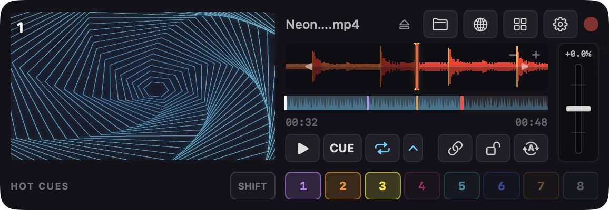
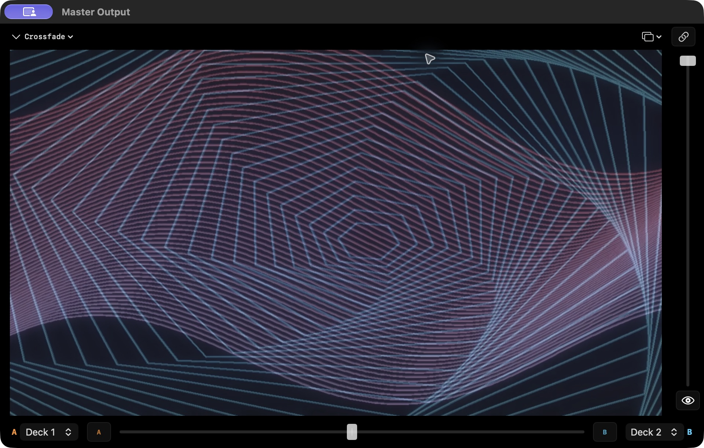
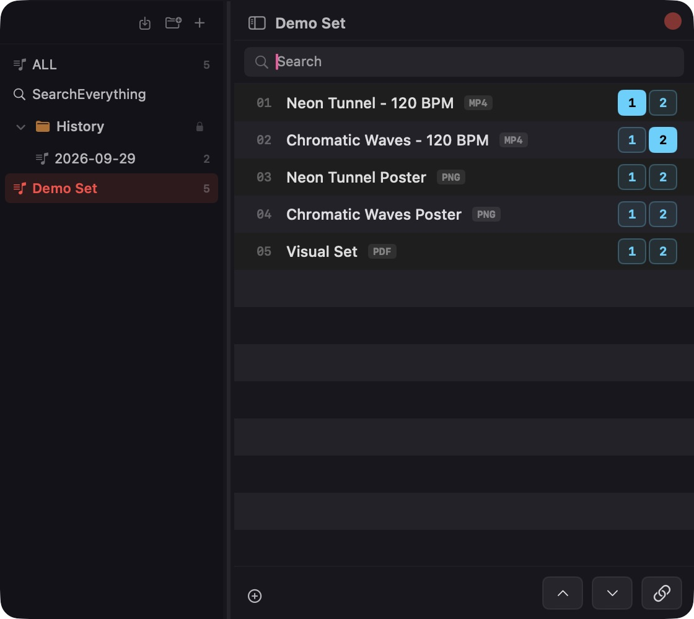
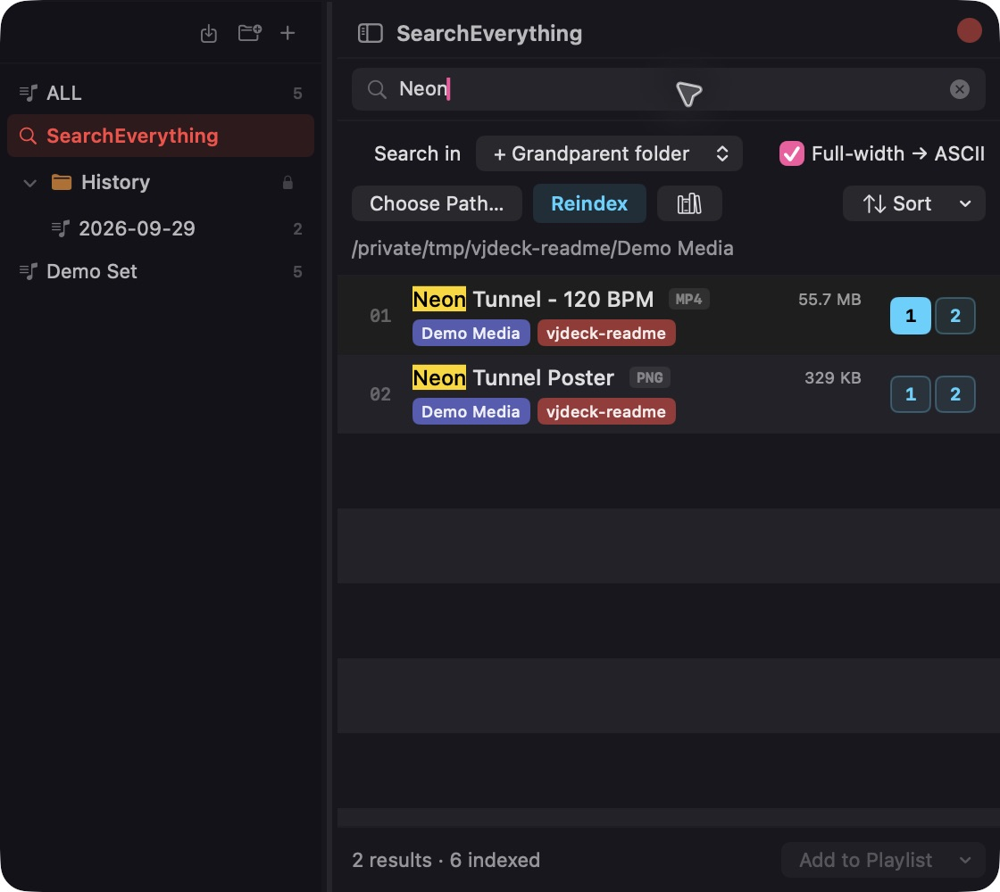

# VJDeck

**macOS용 라이브 비디오 퍼포먼스 덱**

영상·이미지·PDF 또는 Syphon 입력을 덱에 올리고, 여러 덱의 화면을 Master Output에서 섞어 출력할 수 있습니다. 음악에 맞춰 직접 재생 속도를 조절하거나, 영상에 포함된 오디오와 마이크로 듣는 같은 음악의 재생 위치를 자동 동기화할 수도 있습니다.



스크린샷은 현재 소스의 Release 빌드에서 데모 미디어로 촬영했습니다. [촬영 정보](image/README.md)

> **[최신 버전 다운로드](https://github.com/vjdeck/site/releases/latest/download/VJDeck.dmg)** · Apple Silicon Mac · macOS 15.4 이상. DMG를 열고 VJDeck을 Applications 폴더로 옮기세요. 1.6.0부터 자동 업데이트를 지원하며, 기존 버전은 한 번 수동으로 설치해야 합니다.

## 빠르게 시작하기

1. 앱을 실행하면 덱 창이 열립니다. 폴더 버튼의 **Open File…** (`⌘O`)로 로컬 비디오·이미지·PDF를 열거나 파일을 덱에 드래그하세요.
2. 재생 버튼으로 영상을 시작합니다. 덱 오른쪽의 **RATE 페이더**는 재생 속도를 0.90–1.10배로 조절하고, 우클릭하면 1.00배로 돌아갑니다. 루프·뮤트·CUE, 파형 탐색과 마커도 덱에서 조작할 수 있습니다.
3. `⌘N`으로 덱을 추가합니다(최대 4개). 각 덱은 기본적으로 `VJDeck 1`, `VJDeck 2`처럼 별도의 Syphon 서버를 엽니다.
4. `⌘M`으로 **Master Output**을 열어 A/B 덱을 고르고 크로스페이더, 블렌드 모드, 불투명도를 조절합니다. 화면 출력 또는 `Master` Syphon 서버로 믹싱 결과를 받을 수 있습니다.



### 웹 영상과 Syphon 입력

- 덱의 **지구본 버튼** 또는 `⌘L`을 눌러 yt-dlp가 추출할 수 있는 HTTPS 단일 영상 URL(YouTube 개별 영상 등)을 입력하고 **Load**를 누르세요. 다운로드 진행·취소·재시도를 덱에서 확인할 수 있습니다. 다운로드한 영상은 덱 사이에 재사용되는 캐시에 저장됩니다. 기본 캐시 한도는 5 GB이고 설정의 **Cache → Web Video Cache**에서 바꿀 수 있습니다. 재생목록·채널·라이브 영상과 로그인이 필요한 영상은 지원하지 않으며, 사이트나 영상 형식에 따라 다운로드가 실패할 수 있습니다.
- 덱의 **폴더 버튼 → Syphon**에서 실행 중인 서버를 선택하면 그 화면이 덱의 입력이 됩니다. 같은 메뉴에서 연결을 해제할 수 있습니다. 덱별 Syphon 출력과 Master Output의 `Master` 서버는 다른 앱으로 화면을 보낼 때 사용합니다.

### 이미지와 PDF

정지 이미지와 PDF 페이지는 덱에서 회전·반전·확대할 수 있습니다. PDF는 페이지를 한 장씩 표시하며 재생 컨트롤 자리의 이전/다음 버튼으로 넘깁니다. 비디오의 파형·싱크·핫큐는 정지 이미지와 PDF에 적용되지 않습니다. 애니메이션 이미지 파일은 첫 프레임을 정지 이미지로 표시합니다.

## 미디어 정리와 검색

`⌘P`로 **Playlist** 창을 엽니다. 사이드바에서 플레이리스트와 그룹을 만들고, 파일을 추가한 뒤 항목 옆 덱 번호 버튼으로 원하는 덱에 로드할 수 있습니다. M3U 가져오기·내보내기와 최근 로드 기록도 제공합니다.



파일이 많은 경우 사이드바의 **FastFind**를 선택하세요.

1. **Choose Path…**로 검색할 폴더를 고르면 인덱싱이 자동으로 시작됩니다. 완료 후 검색어를 입력할 수 있고, 변경된 파일을 반영하려면 **Reindex**를 누릅니다.
2. 파일명만 검색하거나 상위 폴더 이름까지 포함하도록 범위를 고르고, 정렬 및 전각 문자의 ASCII 변환 옵션을 조절할 수 있습니다.
3. 결과의 덱 버튼으로 바로 로드하거나, 파일을 선택해 **Add to Playlist**로 보냅니다. 우클릭 메뉴에서는 Quick Look, Finder에서 보기, 경로 복사도 사용할 수 있습니다.
4. 책 모양 **Search Library**에서 폴더를 즐겨찾기하고 최근 검색을 다시 열거나 현재 검색 조건을 이름 붙여 저장할 수 있습니다.



## 공연 중 조작

### 오디오 싱크와 재생 속도

동기화할 영상에는 마이크로 듣는 음악과 일치하는 오디오 트랙이 있어야 합니다. 설정(`⌘,`)의 **Audio → Input**에서 마이크를 선택하고 덱의 **Sync** 버튼을 누르면, ShazamKit custom catalog로 영상의 오디오와 마이크 입력을 대조해 재생 위치를 맞춥니다. DJ의 속도 변화와 확인된 곡 점프를 추적하며, 지속적으로 앞서거나 늦으면 **Latency**를 조절하세요. 기본값은 **−120 ms**입니다.

RATE 페이더의 기본값은 **1.00배**이며 범위는 **0.90–1.10배**입니다. 파형 양쪽을 홀드할 때 쓰는 **Slow/Fast 넛지**는 별도 설정이며 기본값은 **0.80/1.20배**입니다. Master Tempo를 켜면 속도를 바꿀 때 피치를 유지합니다.

### 파형, CUE와 핫큐

- 파형을 클릭해 이동하고, 정지 중 드래그로 스크래치할 수 있습니다. 파형 우클릭으로 마커를 추가·제거하며 마커는 파일별로 저장됩니다.
- 핫큐는 기본적으로 접혀 있습니다. 루프 버튼 옆 화살표를 열면 **8개 슬롯**이 나타납니다. 빈 슬롯을 누르면 현재 위치가 저장되고, 지정된 슬롯을 누르면 해당 위치로 이동하며 재생합니다. 우클릭으로 지울 수 있습니다.
- 핫큐는 파일별로 저장됩니다. 슬롯을 접어도 파형의 위치 표시와 MIDI·OSC·키보드 매핑은 유지됩니다. 매핑한 **SHIFT**를 누른 채 핫큐를 실행하면 해당 슬롯을 지울 수 있습니다.

### 재생 범위

- 오버뷰 바 양 끝의 `[` `]` 브래킷을 드래그하면 영상이 재생될 구간을 제한합니다. 재생은 `[`에서 시작하고 `]`에서 끝나며, 루프가 켜져 있으면 `[`로 돌아가 반복합니다.
- 범위 밖은 어둡게 표시되고 탐색·핫큐·CUE 이동도 범위 안으로 제한됩니다. 정지 중에 브래킷을 드래그하면 해당 위치의 프레임을 미리 볼 수 있으며, 설정의 **Marker Magnetic**이 켜져 있으면 마커·핫큐·CUE에 붙습니다.
- 브래킷을 우클릭하면 그 지점만 초기화하고, 시간 표시줄 가운데의 범위 표시를 우클릭하면 범위를 모두 해제합니다. 재생 범위는 마커처럼 파일별로 저장됩니다.
- **Sync**는 범위 안에서만 위치를 맞춥니다. 마이크로 듣는 음악이 범위 밖에 있으면 Sync 버튼이 노란색으로 바뀌고, 영상은 범위를 그대로 반복하다가 음악이 범위 안으로 들어오면 다시 맞춥니다.

### MIDI·OSC 및 키보드 매핑

덱의 링크 버튼으로 매핑 모드를 켜고, 조작할 버튼이나 페이더를 클릭한 뒤 입력을 지정하세요. 버튼 동작은 MIDI 노트·CC, OSC 메시지 또는 키보드 키로 매핑할 수 있습니다. RATE·음량·Master Output 크로스페이더·불투명도 같은 연속 제어에는 MIDI CC나 OSC가 필요하고, Jog Wheel·Jog Ring은 MIDI CC로만 매핑할 수 있습니다. 링크 버튼을 다시 눌러 매핑을 끝냅니다. 덱 재생·싱크·핫큐·RATE·음량, 플레이리스트 이동과 Master Output의 크로스페이더 등은 설정의 **Mapping**에서도 확인·삭제할 수 있습니다.

OSC를 사용하려면 설정의 **Mapping → OSC Input**에서 **Receive OSC**를 켜세요. 기본 UDP 포트는 **8000**이며, 카드에 표시되는 `IP:포트`를 TouchOSC 같은 컨트롤러의 전송 대상으로 지정합니다. 매핑 모드에서 컨트롤을 누르거나 움직이면 그 OSC 주소(예: `/deck1/play`)가 지정됩니다.

- 버튼은 첫 번째 숫자 값이 0보다 크면 누름, 0이면 뗌으로 처리합니다. 값이 없는 메시지는 한 번 누른 것으로 처리합니다. 컨트롤러의 버튼은 토글이 아닌 푸시(momentary) 방식으로 설정하세요.
- 누를 때만 값을 보내는 컨트롤러도 사용할 수 있습니다. 다만 CUE·Slow/Fast·SHIFT처럼 누르고 있는 동안 동작하는 버튼은 뗄 때 0을 보내야 합니다. **Receive OSC**를 끄거나 포트를 바꾸면 OSC로 누르고 있던 버튼은 모두 뗀 것으로 처리됩니다.
- 매핑 모드에서는 대상을 클릭한 뒤 새로 들어오기 시작한 메시지가 지정됩니다. 가속도계처럼 클릭 전부터 계속 들어오던 주소는 무시합니다. 페이지 전환 메시지가 지정되지 않도록 컨트롤러의 페이지는 먼저 바꾼 다음 대상을 클릭하세요.
- 페이더는 0.0–1.0 값을 받으며 범위를 벗어난 값은 끝값으로 맞춥니다.
- 주소는 대소문자까지 정확히 일치해야 하며 `*` 같은 와일드카드 패턴은 지원하지 않습니다. VJDeck은 컨트롤러로 LED·상태 피드백을 보내지 않습니다.
- **Allow From**에 컨트롤러의 IP 주소를 쉼표로 구분해 입력하면 그 기기에서 보낸 메시지만 받습니다. 비워 두면 같은 네트워크의 모든 기기가 덱을 조작할 수 있으니, 공용 네트워크에서는 주소를 지정하거나 사용하지 않을 때 꺼 두세요.
- 카드의 **Last** 줄에서 마지막으로 받은 메시지와 보낸 기기를 확인할 수 있습니다. 허용 목록에 없는 기기의 메시지는 `(blocked)`로 표시됩니다.

| 기본 단축키 | 동작 |
|---|---|
| `⌘O` | 로컬 파일 열기 |
| `⌘L` | 웹 영상 입력 열기 |
| `⌘N` | 새 덱 |
| `⌘P` | Playlist 열기 |
| `⌘M` | Master Output 열기 |
| `⌘,` | 설정 열기 |

설정은 덱 사이에 공유됩니다. Syphon 기본 이름은 `VJDeck`, 재생 프레임 캐시는 **500 MB**, 오디오 피크 노멀라이즈와 Master Tempo는 기본적으로 켜져 있습니다. Master Output 기본값은 **1080p / 60 fps**이며 720p·480p와 30·24 fps도 선택할 수 있습니다.

## 빌드

소스에서 빌드하려면 Apple Silicon Mac(arm64), macOS **15.4 이상**, Xcode **16.3 이상**, [XcodeGen](https://github.com/yonaskolb/XcodeGen) **2.40 이상**이 필요합니다. 최초 준비에는 웹 영상 도구 다운로드를 위한 네트워크 연결이 필요합니다.

```bash
git clone https://github.com/vjdeck/app.git VJDeck
cd VJDeck
./scripts/bootstrap.sh
xcodegen generate
open VJDeck.xcodeproj
```

Xcode에서 **VJDeck** 스킴을 선택하고 `⌘R`로 실행합니다. 터미널 빌드는 다음과 같습니다.

```bash
xcodebuild -project VJDeck.xcodeproj -scheme VJDeck -configuration Debug \
  -destination 'platform=macOS,arch=arm64' -derivedDataPath "$PWD/.build/DerivedData" \
  CODE_SIGNING_ALLOWED=NO build
```

`bootstrap.sh`는 저장소에 포함된 FFmpeg·Syphon 파일과 라이선스 고지문을 확인하고, 고정 버전의 yt-dlp·Deno 및 고지문을 `.web-tools/`에 내려받아 검증합니다. 준비 상태만 다시 확인하려면 `./scripts/bootstrap.sh --verify-only`를 실행하세요. `xcodegen generate`는 bootstrap 다음에 실행해야 합니다. 일반 빌드에 Homebrew FFmpeg나 `.ffmpeg-build/`는 필요하지 않습니다.

테스트와 기여 절차는 [TESTING.md](TESTING.md)와 [CONTRIBUTING.md](CONTRIBUTING.md), URL 호출 방식은 [URL_SCHEME.md](URL_SCHEME.md), FFmpeg 재빌드는 [docs/ffmpeg-rebuild.md](docs/ffmpeg-rebuild.md)를 참고하세요.

버전을 올리고 자동 업데이트용 릴리스를 배포하는 절차는 [버전 올리기와 릴리스 배포 가이드](docs/release-guide.ko.md)를 참고하세요.

## 구현 개요

UI는 SwiftUI, 비디오 재생은 인프로세스 FFmpeg와 가능한 경우 VideoToolbox 가속을 사용합니다. 정지 이미지와 PDF 페이지는 ImageIO/Core Graphics로 준비해 Metal 경로로 표시합니다. 덱과 Master Output의 화면 갱신은 `CADisplayLink`로 구동됩니다.

오디오는 `PCMAudioEngine`의 `AVAudioSourceNode`에서 PCM을 재생하고, Master Tempo에는 Signalsmith Stretch를 사용합니다. 오디오 위치 매칭은 ShazamKit custom catalog가 맡고, 덱별 영상과 A/B 믹스는 Metal 및 Syphon으로 출력합니다.

## 라이선스

[LGPL-2.1](LICENSE). 함께 제공되는 라이브러리와 도구의 고지문은 [Notices/README.md](Notices/README.md)에 정리되어 있습니다.
